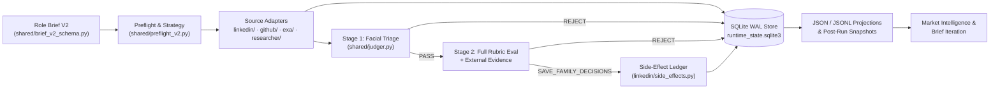

<!-- provenance: status=canonical era=terminal-first stamped=2026-10-15 -->
# Long-Horizon Sourcing Agent

Sourcing for a specialized technical role means running dozens of search variations, reading hundreds of profiles, and deciding on each person against what the hiring manager actually needs. This agent runs that work in sessions that last for hours: starting from a structured role brief, it plans its searches across LinkedIn Recruiter, GitHub, academic publication indexes, and the open web, judges each profile in two passes against the brief, and saves the candidates who pass to the LinkedIn Recruiter pipeline with a written rationale.

An agent that sources for hours has to keep the habits a careful recruiter keeps without thinking about them. It never saves the same candidate twice, and it never re-judges someone it already turned down for the same brief. When a session crashes, it picks up where it stopped, and it halts before a search overspends its budget. It reads what a candidate wrote on their profile as evidence to weigh — never as an instruction — and it never messages a candidate.

<!-- METRIC: candidates reviewed and saved per session, or recruiter hours per search, if Sam supplies it -->

> Curated public snapshot as of 15 October 2026. Private development history, live campaign briefs, and operator run artifacts are omitted.

## System architecture and design choices



### Never acting twice on a candidate or re-grading under the same brief

In a live search, the same engineer surfaces across multiple Boolean queries, and a crash three hours into a session cannot result in saving a candidate twice to LinkedIn Recruiter or paying to re-evaluate someone already rejected for the same role — unless the hiring team revises the brief, when passed-over profiles should be reconsidered. Every session acquires an `fcntl.flock` lock and writes candidate transitions to `runtime_state.sqlite3` in write-ahead log mode via `RuntimeStateStore`. Before scoring a profile, `is_dedup_blocked` and `list_terminal_identity_keys` compare the candidate's prior decision against `brief_content_hash`: saved or recruiter-reviewed candidates stay suppressed permanently, while rejected candidates stay suppressed only while the brief hash is unchanged. Before clicking `Save to pipeline`, `begin_candidate_side_effect` records an idempotency key in `side_effects` and checks the live DOM card so a resumed run never double-saves a candidate in [`shared/runtime_state/store.py`](shared/runtime_state/store.py).

### Two-stage evaluation with untrusted profile fencing

An experienced sourcer does not spend ten minutes reading code and papers for a profile that misses the basic seniority or domain bar on a five-second scan, and knows that keyword-stuffed bios should never dictate how the rubric is applied. The pipeline runs a fast surface triage pass (`facial_judge`) before spending tokens and external lookups on a full capability-rubric evaluation (`full_judge`). Because scraped profiles and repositories contain arbitrary candidate-authored text, `fence_untrusted` wraps every external field inside `<UNTRUSTED_CANDIDATE_DATA>` or `<UNTRUSTED_EXTERNAL_EVIDENCE>` delimiters and calls `_neutralize_control_delimiters` to escape embedded closing tags before the prompt is built, while `untrusted_data_instruction` tells the model to treat fenced text strictly as data in [`shared/judgment/tool_contracts.py`](shared/judgment/tool_contracts.py).

### Pre-dispatch dollar reservation for paid search and inference

When an autonomous agent dispatches search queries and language model calls across concurrent workers, tallying costs after responses arrive is too late to stop a retry loop or an omitted billing field from overrunning a campaign's budget. Before any open-web search or content fetch leaves the process, `ExaCostMeter.reserve` prices the worst-case charge under a lock against the per-run cap (`EXA_RUN_BUDGET_USD`, defaulting to five dollars) and raises `ExaBudgetExhaustedError` before network I/O if the call would cross the ceiling. When a response returns, `ExaCostMeter.settle` swaps the reservation for `costDollars.total` only when that field is present and finite, leaving the worst-case estimate committed if the connection dropped or billing telemetry was omitted in [`exa/cost_meter.py`](exa/cost_meter.py).

### Human-paced browser interaction and session rate governance

LinkedIn Recruiter runs inside an individual recruiter's real account, where teleporting cursors, instant keystrokes, or opening hundreds of profiles back-to-back will trip platform rate limits and lock the seat. The browser adapter attaches over localhost Chrome DevTools Protocol to an already authenticated Chrome session, moves the pointer along cubic Bézier paths, reads profile sections on log-normal timers capped at 35 seconds per profile, and types queries and notes (`build_boolean_typing_plan` and `build_note_typing_plan`) with operator pauses and bounded typos with `Backspace` recovery. Across every run, `SessionGovernor` enforces hard ceilings of 200 profile opens per session (`MAX_PROFILE_OPENS_PER_SESSION`) and 400 per rolling 24 hours (`MAX_PROFILE_OPENS_PER_24H`), refuses to start on unreadable state (`GovernorStateUnreadable`), and persists a 6-hour cooldown via `force_backoff` on rate-limiting in [`shared/governor.py`](shared/governor.py).

### Deterministic Boolean scoring, lexicon enrichment, and RL sidecar gating

A strong sourcer writes Boolean queries that pair a role-defining class anchor with a focused synonym sweep, avoiding unquoted multi-word phrases, operator errors, and noisy grab-bag terms. Before a generated LinkedIn Recruiter string executes or adapts mid-run, `parse` and `score` grade it against a 207-concept role lexicon for syntax legality, query shape, synonym coverage, and 12 bloat penalties. When opt-in enrichment is enabled, the rule-based enricher expands missing common forms and hyphen twins, and `_improve` queries the local `boolean-search-rl` sidecar (`POST /enrich`) for unseen terms or missing class anchors — accepting a rewrite in `_best` only if it clears anti-padding and stem-preservation gates and lifts `log_composite` by more than `MIN_GAIN` (0.01) in [`linkedin/boolean_sidecar.py`](linkedin/boolean_sidecar.py).

## Quickstart and reference

From a fresh clone on Python 3.12+:

```bash
python3 -m venv .venv
.venv/bin/pip install -r requirements.txt
.venv/bin/python -m rebrowser_playwright install chromium   # add --with-deps on Linux
CLORIS_SKIP_STARTUP_VALIDATION=1 make validate
```

`make validate` runs `tools/check_repo_hygiene.py`, `tools/flag_ledger.py`, and the offline `pytest` suite (403 test modules across 412 Python files under `tests/`, including the 20 build-gated mutation sentinels in `tests/test_mutation_sentinels.py`) without network access, API keys, or a signed-in browser; the browser tests drive the headless Chromium installed above, and `CLORIS_SKIP_STARTUP_VALIDATION=1` skips the startup check for live API keys.

To run individual verification tools directly:

```bash
.venv/bin/python tools/flag_ledger.py --as-of 2026-10-15
.venv/bin/python tools/lint_role_agnosticism.py
.venv/bin/python tools/lint_vertical_vocab.py
.venv/bin/python tools/lint_code_bloat.py
.venv/bin/pytest tests/test_mutation_sentinels.py tests/test_mutation_survey.py -q
```

### Further reading

- [`docs/technical-reference.md`](docs/technical-reference.md) — the full technical description: every mechanism, constant and file, and how correctness is verified.
- [`docs/INDEX.md`](docs/INDEX.md) — index of design notes, primary modules, and scope boundaries.
- [`docs/runtime-state-and-recovery.md`](docs/runtime-state-and-recovery.md) — SQLite WAL state model, `fcntl.flock` locking, the `side_effects` ledger, `--resume` reconciliation, and `tools/cloris_watchdog.py`.
- [`docs/spend-metering-and-governance.md`](docs/spend-metering-and-governance.md) — pre-dispatch dollar reservation, Fireworks spend guard, session rate governance, and LLM telemetry.
- [`docs/browser-automation-and-session-pacing.md`](docs/browser-automation-and-session-pacing.md) — CDP and macOS HID input backends, Ghost Cursor trajectories, human timing, and decoy browsing (`decoy/`).
- [`docs/boolean-scoring-and-enrichment.md`](docs/boolean-scoring-and-enrichment.md) — Boolean parser, 207-concept scorer, lexicon enrichment, and RL sidecar gating.
- [`docs/verification-and-mutation-testing.md`](docs/verification-and-mutation-testing.md) — mutation sentinels, `tools/mutation_survey.py`, untrusted text fencing, `tools/shadow_replay.py`, and static ratchets.

## License

MIT License. See [`LICENSE`](LICENSE).
